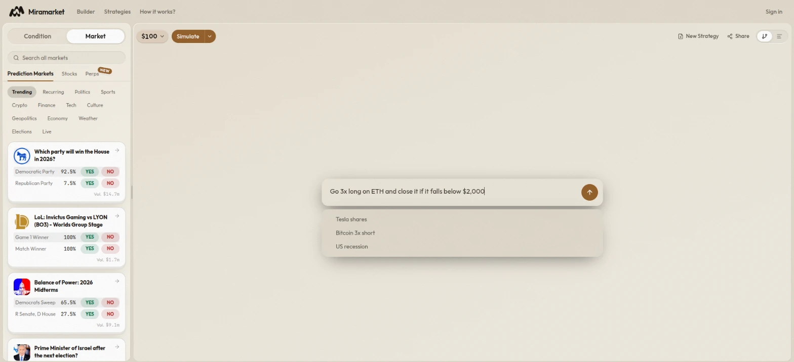
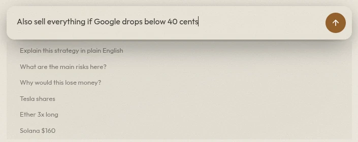

The strategy assistant builds a strategy from a plain-English description. It is the chatbox in the middle of the [home page](/strategy-builder/featured-strategies) and of an empty canvas in the [builder](/strategy-builder/overview). Once the canvas has nodes, it sits along the bottom edge of the canvas.

Sign in to use the assistant. A strategy it builds is a starting point: review it like any other strategy and use **Simulate** before **Run Live**.

## Describe a strategy

Type what you want the strategy to do, then press **Send**. Name the market, the side, and the prices or times that matter:

- "Buy `YES` on the Fed cutting rates in December if it drops below 40¢, sell everything at 70¢."
- "Buy TSLA if it crosses $400 and sell at $450."
- "Go 3x long on ETH and close it if it falls below $2,000."

When a buy depends on whether something happens, such as "If the Fed cuts in December, buy $25 of Micron", the buy waits for that market to resolve the way you named. It does not buy when the odds pass 50%, and if the market resolves the other way, the buy does not happen. If you mean odds, say so: "Buy Micron once a December cut passes 70%."

Give an exit as a percent, such as "take profit at +20% and stop at -10%", and the assistant adds an [ROI Condition](/strategy-builder/conditions#roi-condition), which measures it from what the buy actually paid. Give it as a price, such as "sell at 70¢", and it uses that price. If a take-profit could never be reached, such as `+30%` on a share bought at `85¢` (it would need more than `$1`), the assistant leaves it out and says why.

You do not have to give an exit. A prediction market bought with no exit is held until it resolves. A perp or a stock with no exit is closed as soon as the run completes, which is right after the buy, so to hold one, give it a deadline ("until Dec 5"), a stop, or a take-profit.

The chatbox suggests a few sample prompts to start from. Click one to send it.

The assistant keeps strategies simple unless you ask for more: a few conditions and up to two markets. Ask for a detailed or hedged strategy if you want more steps. When you name the position yourself, it adds only the exits you asked for.

### Strategies use more than one venue

By default, the assistant spreads a strategy across two venues when it can. When you name a trade on one venue, it adds one related position on another venue that bets the same way. For example, beside a Nasdaq short on Hyperliquid, it might buy `YES` on a Polymarket market about stocks falling.

- **Budget:** the total stays the amount you set. The related position gets 30% of it, and the amounts you named get the other 70%. For example, a $20 short becomes a $14 short and a $6 related position.
- **Timing:** it opens when your trade opens, and a "sell everything" exit you set sells it too.
- **What it tells you:** the reply names the added position and how to remove it. When nothing related fits, or your trade would fall under a venue's minimum after the split, it says the strategy stays on one venue and why.
- **To keep one venue:** say so, for example "just short BTC 2x with $30" or "only this trade, nothing else". You can also ask it to remove the added position afterward.

There is no related position for sports, entertainment, weather, or election markets, or when your request is already on two venues.

## Describe a situation instead

You do not have to choose the market yourself. Describe a news situation or an event, such as "build a strategy around this week's Fed meeting", and the assistant researches it first:

1. It reads recent news about the situation. One headline at a time appears under the progress line, with its source.
2. It finds the markets the situation could move.
3. It designs a strategy from what it read, on two venues when the situation has markets on both (for example, a Polymarket market and a Hyperliquid perp).

The strategy buys as soon as it starts. A market it watches is usually an exit that sells if the situation turns against the trade, not a condition the buy waits for. It waits before buying only when you ask it to, for example "once the merger passes 65%, buy Tesla".

Its reply is two sentences: why it chose these markets, then what the strategy does. Check that the reasoning matches your view of the situation before you run it.

## Answer its questions

When a request could mean several markets, the assistant asks which one you meant. It shows the candidate markets grouped by event, or the different ways it could read your request. Select one and click **Confirm**.

If something is missing, such as a price or a side, it asks for it instead of guessing. Reply in the chatbox.

If the event you name is already over, such as an election that has been held, the assistant tells you instead of building on a different market.

## Edit or explain the current strategy

Once a strategy exists, use the same chatbox to change it or ask about it:

- "Also sell everything below 30¢."
- **Explain this strategy in plain English**
- **What are the main risks here?**
- **Why would this lose money?**

The last three are offered as suggestions once a strategy exists.

## Use the strategy it builds

A built strategy appears in the conversation under **Strategy created**. When one short sentence can say what it does, it reads as that sentence, for example "`LONG` `$10` of BTC at `2x`, exit below `$60,000`." Otherwise it is drawn as a small graph of its first steps; click **+N more steps** to see the rest.

In the sentence, a perp or a stock appears as its ticker with its live price. Hover over a `YES` or `NO` to see that side's current price.

- **Amount**: type to change how much the strategy starts with.
- **Run control**: **Simulate**, or **Run Live** from its menu, runs the strategy from the conversation.
- **The steps**: click them to open the strategy on the canvas, where you can review and edit every node.

Opening a generated strategy on the canvas replaces what is there. You can undo it. While a run is active on the canvas, the canvas is locked and a generated strategy cannot replace it.

## Languages

Write in English for the most reliable results. If you write in Korean, Japanese, Chinese, Russian, or Arabic, the assistant replies in that language.

## Before you run

The assistant builds what it understood, not necessarily what you meant. Before any run:

- Confirm every market, named outcome, and side, or `LONG` or `SHORT` for a [perp](/strategy-builder/perps).
- Check every threshold, time, and allocation.
- Use **Simulate** first, then the [live-run checklist](/strategy-builder/validation) before **Run Live**.

Execution and fills are not guaranteed.
