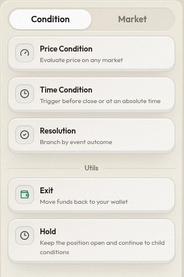

A condition is a rule on the canvas. When the rule is met, the strategy can continue to the next action or condition.

## Add a condition

Open **Condition** in the left panel. Click a card to add it at the current position, or drag it to place it before, after, or below another node. Configure the node after you add it.

## Compare conditions

| Condition | What it watches | Best for |
| --- | --- | --- |
| **Price Condition** | A market price, or a stock or perp price in dollars | Waiting for a price level before continuing. |
| **ROI Condition** | The percent return on the position bought just above it | Taking profit or stopping a loss at a percent, such as `+20%` or `-10%`. |
| **Time Condition** | A market close time or calendar time | Timing a later step. |
| **Resolution** | The final result of a selected market | Sending different outcomes down different paths. |

## Price Condition

Use **Price Condition** when a selected market side must reach a price before the strategy continues. Choose the market and side to watch, then set the comparison and threshold. Depending on your strategy, it can watch the market you are about to trade, a market from an earlier step, or another market you select.

Examples:

- "If the selected `YES` side is greater than `60¢`, continue."
- "If the selected `NO` side is less than `40¢`, continue."

Check the side and comparison carefully. `>` and `<` produce opposite behavior. A displayed market price is not a guarantee that an action will execute at that exact price.

If you add more than one rule to the same condition, every rule must be met. For example, you can wait for a `YES` side to reach `60¢` **and** for the market to be within ten minutes of close.

A price condition can also watch a [tokenized stock](/strategy-builder/markets#tokenized-stocks). The threshold is then a share price in dollars rather than a probability: "if TSLA is greater than `$400`, continue." The condition watches the stock's reference share price, which usually sits slightly below the pool price a trade pays. A few newer stocks, such as Palantir and Micron, have no reference price yet; a condition on one of them watches the pool's average price over the last 15 minutes, which lags the pool price after a fast move.

A price condition can watch a [perp](/strategy-builder/perps) the same way, in dollars: "if BTC is less than `$80,000`, continue." It watches Hyperliquid's price for that perp. A perp condition has no `LONG` or `SHORT` choice; the price is the same for both sides.

## ROI Condition

Use **ROI Condition** when you want to act on how much a position has gained or lost, in percent, rather than on a price. It measures the return on the position bought just above it, from what that buy actually paid, so you do not need to work out an exit price yourself.

Add it below a market action, or below a **Hold** that keeps that position. It has no market of its own: it always follows the market and side of the buy above it, and keeps following them if you change that buy. If there is no buy above it, the builder refuses it and says so.

The node reads **ROI reaches `+20%`**, which is where a new one starts. Click the `+` or `-` sign to switch direction, and click the number to change the amount:

- "ROI reaches `+20%`" is a take-profit. It continues once the position is up 20%.
- "ROI reaches `-10%`" is a stop-loss. It continues once the position is down 10%.

Add **Exit** after it to sell the position when it continues. To have both a take-profit and a stop-loss, add two ROI conditions below the same market action, each with its own **Exit**. Whichever is reached first runs, and the other is skipped.

How the return is measured:

- **The trading fee you paid to buy counts as part of the cost.** A new position therefore starts slightly down: about 3–4% on a Polymarket market, well under 1% on a stock or a perp. For example, `YES` bought at `50¢` with a 3% fee reaches `+20%` at about `62¢`.
- **The fee to sell is not counted,** so the money you take home lands a little under the percent you set.
- **A prediction-market position is valued at the best bid,** what a sale would get right now, not the midpoint price.
- **A perp's return is on its margin.** At `5x` leverage, `+10%` is a 2% move in the price. For a `SHORT`, a gain means the price fell. You still set `+` for a take-profit and `-` for a stop-loss.
- **The same signs work for every position:** `YES`, `NO`, a stock, a `LONG`, or a `SHORT`.

An ROI condition made outside the builder, for example by the CLI, can read **ROI falls to** or **ROI rises to**, such as a lock-in that sells if a gain shrinks back to `+10%`. It keeps that direction when you change its amount.

## Time Condition

Use **Time Condition** when the strategy should continue before a market closes or at a specific time. Choose the market first, then set the timing mode and value.

Examples:

- "Continue 10 minutes before the selected market closes."
- "Continue at the chosen date and time."

Time conditions watch Polymarket markets. A tokenized stock or a perp has no close time, so a Time Condition cannot watch one. If the builder does not offer the timing you need for a market, choose a different condition or market.

## Resolution

Use **Resolution** when the next step depends on a selected market outcome. The node branches according to the outcome that resolves.

Examples:

- "If the selected outcome resolves `YES`, continue to this branch."
- "If it resolves `NO`, continue to the other branch."

Use this condition only when you understand how the market resolves and what each branch of the strategy will do. Stocks and perps never resolve, so Resolution cannot watch them.

## Before you run

| Check | Why it matters |
| --- | --- |
| Watched market and side | A condition can watch a different market from the one an action buys. |
| Price or ROI | A Price Condition waits for a price level. An ROI Condition waits for a percent return on the position above it. |
| Time mode | Market close and final resolution can happen at different times. |
| Follow-up action | A condition without an action only watches; it does not move funds. |

## Choose the right condition

Ask yourself:

- Do you need a price threshold? Use **Price Condition**.
- Do you want to take profit or stop a loss at a percent? Use **ROI Condition**.
- Do you need a time trigger? Use **Time Condition**.
- Do you need to branch after an outcome resolves? Use **Resolution**.

## Common mistakes

- Watching the wrong market or side.
- Reversing a price comparison.
- Treating market close and market resolution as the same moment.
- Entering a probability where a stock or perp condition expects dollars. A stock threshold of `0.6` means sixty cents a share, not 60%.
- Setting a short's stop-loss below the entry price. A short loses money as the price rises, so its stop-loss is a price above where you entered.
- Setting an ROI stop-loss tighter than the trading fee. On Polymarket a new position starts about 3–4% down, so a stop at `-2%` sells right after the buy. Keep a Polymarket stop at `-8%` or beyond, such as `-10%`.
- Setting a take-profit no price can reach. A prediction-market share never trades above `$1`, so `+20%` on `YES` bought at `90¢` would need `$1.08` and never continues.
- Using **Run Live** before testing with **Simulate**.

See [Strategy builder nodes](/strategy-builder/nodes) for a concise node reference and [Strategy examples](/strategy-builder/examples) for complete patterns.
