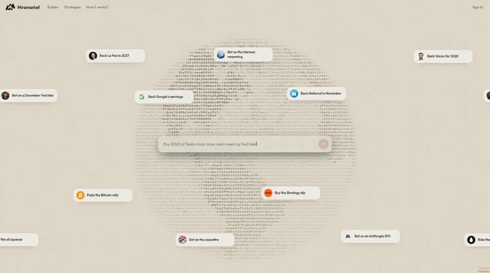
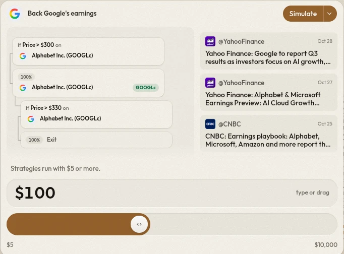

[app.miramarket.org](https://app.miramarket.org) opens on the home page. It has two ways to start:

- The chatbox in the middle is the [strategy assistant](/strategy-builder/assistant). Describe a strategy or a news situation and it builds one in the conversation.
- Featured strategies drift across the page around the chatbox. Each one is a ready-made strategy, usually built around a recent news story.

To build a strategy node by node instead, choose **Builder** in the top bar. The canvas lives at `app.miramarket.org/builder`.

## Open a featured strategy

Hover over a featured strategy, or tap it on a touch screen, to open it into a window. Click or tap inside the window to keep it open; click outside it or press `Escape` to close it.

The window shows:

- The strategy itself. When one short sentence can say what it does, it reads as that sentence; otherwise it is a small graph of its steps. A perp or a stock appears as its ticker, and in a sentence with its live price. Click the strategy to open it on the canvas, where you can see every node and edit it.
- The news story behind the strategy, with a link to read the source.
- The amount to run it with.
- The run control: **Simulate**, or **Run Live** from its menu.

## Run a featured strategy

1. Set the amount. Type it or drag it. Strategies run with `$5` or more, up to `$10,000` or your Cash, whichever is lower.
2. Choose **Simulate** to run it without real trades, or **Run Live** from the run control's menu.
3. **Run Live** asks you to confirm before it starts.

You need to be signed in to run a featured strategy, including a simulation. When the run starts, select **View run** in the notification to follow it.

A featured strategy reflects its author's reading of the news, not necessarily yours. Before you run it, open it on the canvas and check every market, side, threshold, and allocation. Use the [live-run checklist](/strategy-builder/validation) before **Run Live**. Execution and fills are not guaranteed.

## Featured strategies change

Featured strategies come and go as the news moves on. They have no page of their own: an older `app.miramarket.org/featured/<name>` link opens the home page. To keep a featured strategy, open it on the canvas and use **Share** there, or run it.

## Continue learning

- [Strategy assistant](/strategy-builder/assistant)
- [Strategy builder overview](/strategy-builder/overview)
- [Simulation and Live Runs](/strategy-builder/run-simulation-live)
